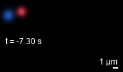

# Microscopy Workbench

Local, reproducible microscopy workflows for iGEM teams and researchers: inspect calibrated three-dimensional image stacks and export full-field or fixed-ROI time series as GIF and MP4.

[中文说明](README.zh-CN.md) · [Methods and interpretation](docs/METHODS.md) · [Validation](docs/VALIDATION.md) · [Outputs](docs/OUTPUTS.md) · [Download a release](https://github.com/xuanyuelingwu/microscopy-workbench/releases)

The browser interface runs against a Python service on `127.0.0.1`. Images are processed locally. A Python backend is required; opening the HTML file by itself does not parse ND2.

## What it does

| Workflow | Capabilities | Interpretation |
| --- | --- | --- |
| Native-position 3D view | Calibrated acquired XYZ samples, independent channel opacity, acquired-plane slices and same-position coincidence | Display sampling is explicit; numerical overlap uses all acquired pixels. |
| Intensity isosurfaces | Marching-cubes surfaces, rotation and PLY export, including recorded nonuniform Z coordinates | Surfaces interpolate between acquired samples; they do not add measured resolution. |
| Time-series export | Full-field preview; a fixed ROI selected on any native frame; inclusive time interval and an independent time zero | One display mapping is held across the clip. There is no automatic tracking or drift correction. |
| GIF and MP4 | Full-field and cropped files, calibrated scale bars and timestamps in a separate footer | Recorded timing is approximated within the limits of each encoding format. |
| Replay | Saved settings, source SHA-256, software/code fingerprints and frame maps | Recompute a protocol from its original input; apply it to a different file only explicitly. |

## Install and start

Use **Python 3.12**. Primary dependencies are pinned in [requirements.txt](requirements.txt). The complete freshly installed Windows/Python 3.12 environment is recorded in [requirements-lock-windows-py312.txt](requirements-lock-windows-py312.txt). Installation needs an internet connection; normal operation is offline after dependencies are installed. A local Plotly JavaScript bundle is included.

On Windows, download and extract the release ZIP, run `install.bat`, then `start.bat`. Keep the local service running while using its browser page.

For a manual installation on Windows:

```powershell
py -3.12 -m venv .venv
.venv\Scripts\python -m pip install -r requirements.txt
.venv\Scripts\python app.py
```

On Linux or macOS:

```sh
python3.12 -m venv .venv
.venv/bin/python -m pip install -r requirements.txt
.venv/bin/python app.py
```

The service normally starts on port 8876 and tries the following ports when necessary. Its printed URL contains a local session token. `python app.py --no-browser` starts the service without opening a browser.

The current interface is in Chinese. The English [walkthrough](docs/QUICKSTART_EN.md) maps the controls to their functions. This initial release was developed and interactively reviewed on Windows; the [CI workflow](.github/workflows/ci.yml) runs the portable tests on Windows and Linux. Platform support should be judged from the actual CI results, not from these installation commands alone.

## Supported inputs

- **Nikon ND2:** grayscale channels, read one native acquisition frame at a time. Time, Z and stage-position dimensions are selected explicitly.
- **OME-TIFF:** a single image series with explicit grayscale axes and physical calibration. The included examples exercise nonuniform Z positions and irregular acquisition times.
- A 3D task needs at least two Z planes; a video task needs at least two time points. Supply known calibration or timing values explicitly when usable metadata are missing.

RGB-camera ND2, ambiguous TIFF axes such as `Q`, `I` or `S`, multiple OME-TIFF series and incomplete downloads are not supported. Ordinary image folders, CZI, LIF and arbitrary image/video formats are not accepted directly. TIFF conversion should preserve OME axes, units and timing; the program does not guess these from array shape.

## Try the synthetic examples

The two OME-TIFF files in [examples/](examples/) are **synthetic software demonstrations, not biological results**. Their generator, saved configurations and independent expected numerical values are included.

```sh
python replay.py --source examples/SYNTHETIC_nonuniform_Z.ome.tif --settings examples/volume_settings.json --output demo_volume
python replay.py --source examples/SYNTHETIC_irregular_time.ome.tif --settings examples/video_settings.json --output demo_video
```

Open `demo_volume/viewer.html` to inspect the two 3D methods. The video command produces `full.gif`, `full.mp4`, `crop.gif` and `crop.mp4`.

The synthetic time-series example is shown below when viewing the repository on GitHub. It is not an experimental observation.



## Reproduce a result

```sh
python replay.py --source original.nd2 --settings saved_result/settings.json --output replayed_result
```

The saved source SHA-256 must match by default. `--allow-different-source` explicitly applies the configuration to a new input and records that change. Output directories must be absent or empty. Numerical results, ROI coordinates, native-frame maps and settings can be checked across runs; lossy media bytes need not match across operating systems or encoder builds.

Each result includes `settings.json`, source metadata, `software_versions.json`, `METHODS.txt`, numerical CSV files and a checksum manifest. Result ZIPs omit the original ND2 file. Provenance files still record the user's local source path; review them when sharing a generated result. See [the output reference](docs/OUTPUTS.md).

## Scientific scope

The tool measures thresholded spatial coincidence on acquired samples. It does not infer molecular binding, absolute concentration, liquid material state or biological treatment significance. Pooled overlap retains acquisition-dependent channel weights. The threshold shown in the interface is an editable starting point, not a validated universal setting.

The current version does not perform deconvolution, super-resolution, automatic cell/nuclear segmentation, droplet tracking, FRAP model fitting, channel registration or automatic drift correction. Three-dimensional integrals sum background-corrected intensity × XY pixel area over acquired planes; they are **not continuous volume integrals**. Z projections are not substituted for acquired-plane coincidence.

Large volumes and dense meshes can exceed workstation or browser memory. ND2 time sequences are read frame by frame, but 3D rendering still assembles the selected volume in memory. Reducing displayed points changes the view rather than the native-pixel overlap calculation. See [methods and limits](docs/METHODS.md) before interpreting a result.

## Validation and community contribution

Run the portable checks with:

```sh
python -m unittest discover -s tests -p "test_*.py" -v
```

The original ten numerical and synthetic export tests cover strict threshold boundaries, overlap integrals, real sample coordinates, nonuniform Z interpolation, timing quantization, odd image sizes, fixed LUTs and TIFF-axis handling. The public release adds tests for package contents. Previous project checks also used three real ND2 recordings and reviewed the interactive browser operations; those project images are not distributed. Exact scope and current reports are in [docs/VALIDATION.md](docs/VALIDATION.md) and [validation/](validation/).

Developed during the NucleArk microscopy project, this repository makes its 3D inspection and video-export processing core available for other teams to inspect, replay and use on their own data. It provides a reusable analysis tool and synthetic verification material. It does not claim independent laboratory validation, broad microscope compatibility or adoption by other teams.

## License, citation and contributions

Workbench code and documentation use the [MIT License](LICENSE). Dependencies retain their own licenses; see [third-party notices](THIRD_PARTY_NOTICES.txt) and [bundled license texts](third_party_licenses/).

Use GitHub's **Cite this repository** entry or [CITATION.cff](CITATION.cff), and report the software version, processing settings and source-data identity in your methods. Reuse and modification by iGEM teams and other researchers are welcome. [CONTRIBUTING.md](CONTRIBUTING.md) explains how to report reproducible issues or propose changes.
